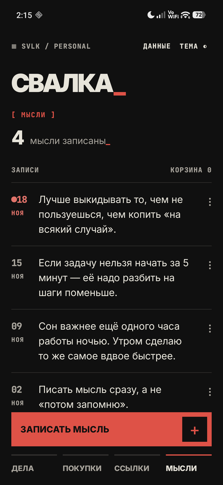

# СВАЛКА

**Дела, покупки, ссылки и мысли — в одном месте.** Запишите дело, поставьте напоминание, сохраните ссылку или мысль; выполненное можно убрать, а удалённое — вернуть из корзины.

**Android 7+ и Windows 10/11 · версия 2.0 · данные на устройстве, синхронизация через свой сервер**

[**Скачать APK**](https://github.com/cveloy102/reminder/releases/download/v2.0/Svalka-2.0.apk) · [**Windows**](https://github.com/cveloy102/reminder/releases/download/v2.0/Svalka-Windows-0.3.3.exe) · [Релиз 2.0](https://github.com/cveloy102/reminder/releases/tag/v2.0) · [История версий](CHANGELOG.md) · [Сборка](docs/DEVELOPMENT.md) · [Свой сервер синхронизации](docs/SELF_HOSTING.md)

## Интерфейс

<table>
<tr><td align="center"> Дела и напоминания</td><td align="center"> Мысли</td><td align="center"> Редактирование мысли</td></tr>
</table>

## Возможности

- Четыре списка: дела, покупки, ссылки и мысли; у каждого своя корзина.
- Напоминания с датой и временем, повтор каждый день, неделю или месяц.
- Кнопки в уведомлении: «Готово», «Через 15 мин», «Через 1 час».
- Мысли с датой записи, многострочным вводом и кнопкой «Поделиться».
- Приём ссылок и текста из других приложений через «Поделиться → СВАЛКА».
- Закрепление и перестановка записей, выполненное ниже активного.
- «Очистить купленное» одной кнопкой; корзина очищается сама через 30 дней.
- Отмена удаления свайпом в течение десяти секунд.
- Резервная копия в файл и автокопия в выбранный файл Google Drive.
- Светлая, тёмная и системная темы в стиле Терминал, встроенные шрифты Inter и JetBrains Mono.

## Начало работы

1. Установите APK из релиза. Для приватного репозитория требуется вход в GitHub с доступом.
2. Добавьте первое дело и при необходимости поставьте напоминание с повтором.
3. Разрешите уведомления и точные напоминания, когда Android предложит. Проверьте уведомление на коротком напоминании.
4. Ссылки удобно отправлять из браузера через «Поделиться»; мысли записывайте во вкладке «Мысли».
5. В разделе **Данные** сохраните резервную копию или выберите файл Google Drive для автокопии.

## Напоминания и данные

Записи хранятся локально. Облачная копия подключается по желанию: приложение обновляет выбранный файл, а Google Drive завершает загрузку при наличии сети. Пустой список автоматически в облако не записывается. Восстановление из файла может добавить только новые записи или заменить всё — перед заменой сохраните отдельную копию.

Если файл данных окажется повреждён, приложение не падает: файл откладывается в сторону, а на экране появляется сообщение.

Энергосбережение Android может влиять на доставку уведомлений. Для важного напоминания проверьте разрешения на своём телефоне. Приложение проверялось на POCO (HyperOS, Android 16).

## В версии 2.0

- Синхронизация телефона и компьютера через свой сервер: правки приходят за секунды. Как поднять сервер — [docs/SELF_HOSTING.md](docs/SELF_HOSTING.md).
- Версия для Windows с теми же списками, напоминаниями и копиями ([windows/README.md](windows/README.md)).
- Вкладка «Мысли», повторяющиеся напоминания и кнопки в уведомлении (с версий 1.8–1.9).

Подробности — в [CHANGELOG](CHANGELOG.md).
