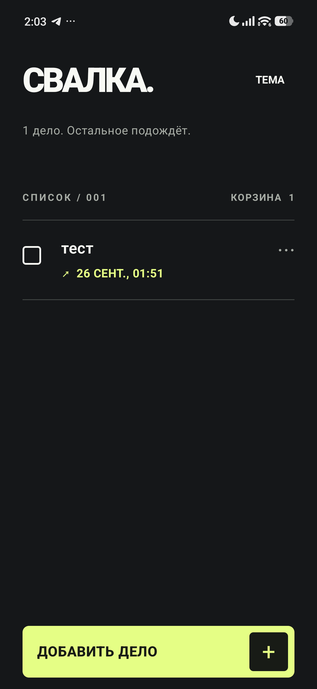
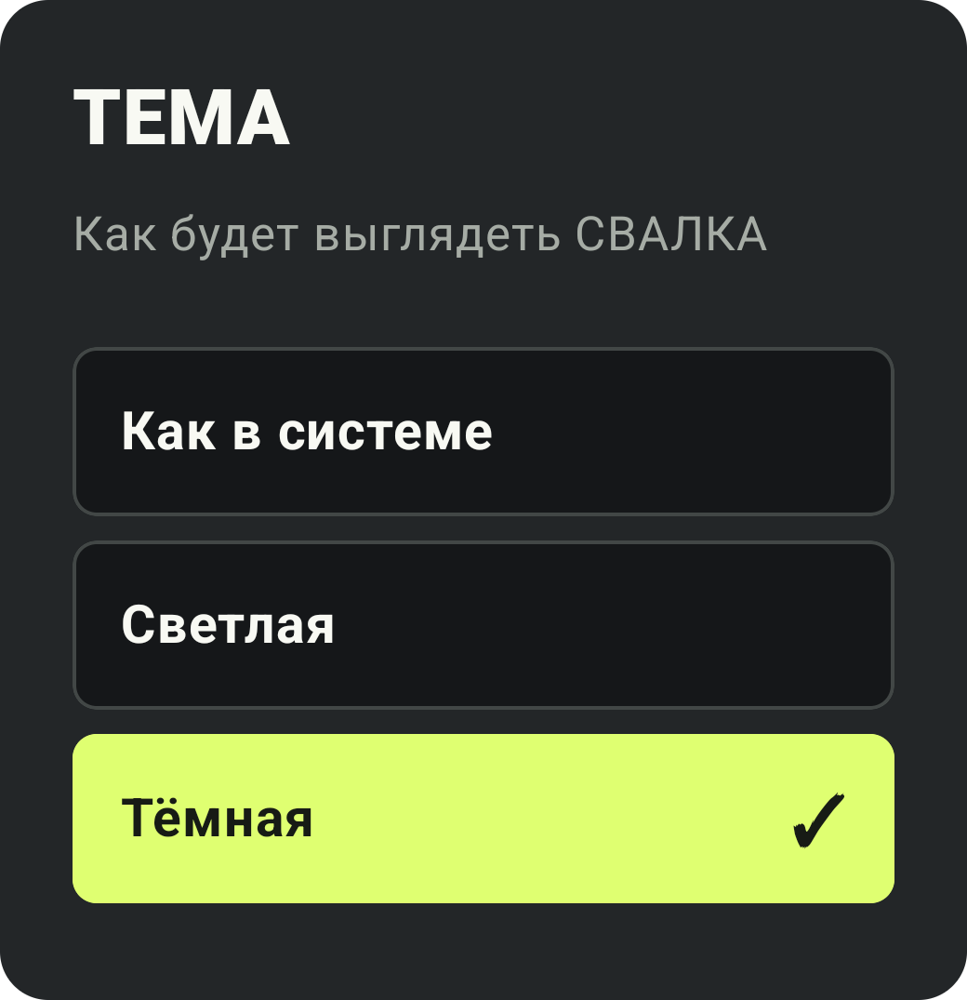
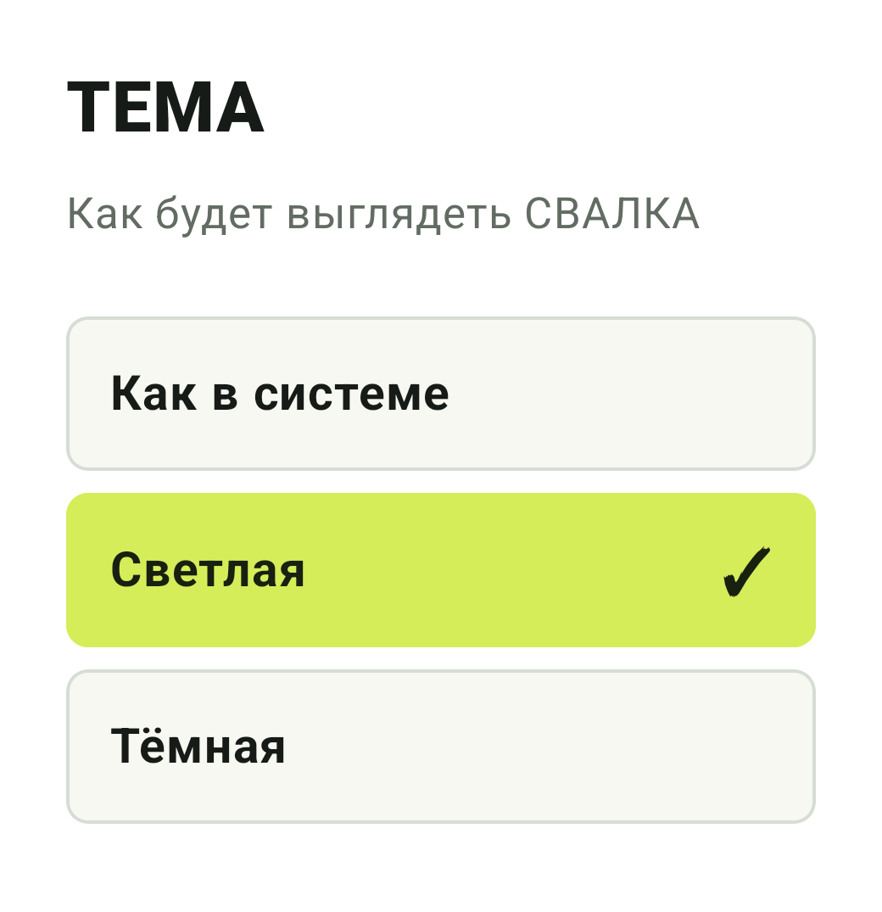

# СВАЛКА

**Дела, покупки и ссылки — в одном месте.** Запишите мысль, поставьте напоминание или сохраните ссылку; выполненное можно убрать, а удалённое — восстановить из корзины.

**Android 9+ · версия 1.7.1 · данные на устройстве**

[**Скачать APK**](https://github.com/cveloy102/reminder/releases/download/v1.7.1/Svalka-1.7.1.apk) · [Релиз 1.7.1](https://github.com/cveloy102/reminder/releases/tag/v1.7.1) · [История версий](CHANGELOG.md) · [Сборка](docs/DEVELOPMENT.md)

## Интерфейс

<table>
<tr><td align="center"> Дело с напоминанием</td><td align="center"> Тёмное оформление</td><td align="center"> Светлое оформление</td></tr>
</table>

Сохранённые снимки базового оформления списка и выбора темы. В текущей версии дополнительно доступны стили **Терминал** и **Сигнал**; показанный экран списка относится к более ранней сборке.

## Возможности

- Дела с редактированием текста, закреплением и изменением порядка.
- Напоминания с датой, временем и звуковым уведомлением.
- Выполненные дела размещаются ниже активных.
- Отдельный список покупок и корзины для восстановления удалённых записей.
- Сохранение ссылок с необязательными названиями.
- Отмена удаления свайпом в течение десяти секунд.
- Ручное сохранение и восстановление данных, обновление выбранного файла в Google Drive.
- Светлая, тёмная и системная темы, стили Терминал и Сигнал.

## Начало работы

1. Установите APK из релиза. Для приватного репозитория требуется вход в GitHub с доступом.
2. Добавьте первое дело и при необходимости установите дату и время напоминания.
3. Разрешите уведомления, когда Android предложит это сделать. Проверьте уведомление на коротком напоминании.
4. Используйте отдельные разделы для покупок и ссылок; важные дела закрепляйте.
5. В разделе **Данные** сохраните резервную копию или выберите файл Google Drive для обновлений.

## Напоминания и данные

Записи хранятся локально. Облачная копия подключается по желанию пользователя: приложение обновляет выбранный файл, а Google Drive завершает загрузку при наличии сети. Восстановление заменяет текущие данные — перед ним можно сохранить отдельную копию.

Энергосбережение Android и настройки фоновой работы могут влиять на доставку уведомлений. Для важного напоминания проверьте разрешения и поведение на своём телефоне. Приложение проверялось на POCO.

## В версии 1.7.1

- Из списка в стиле Терминал убраны номера строк.
- Сохранены красная иконка и упрощённая навигация версии 1.7.

История покупок, ссылок, резервных копий и стилей — в [CHANGELOG](CHANGELOG.md).
