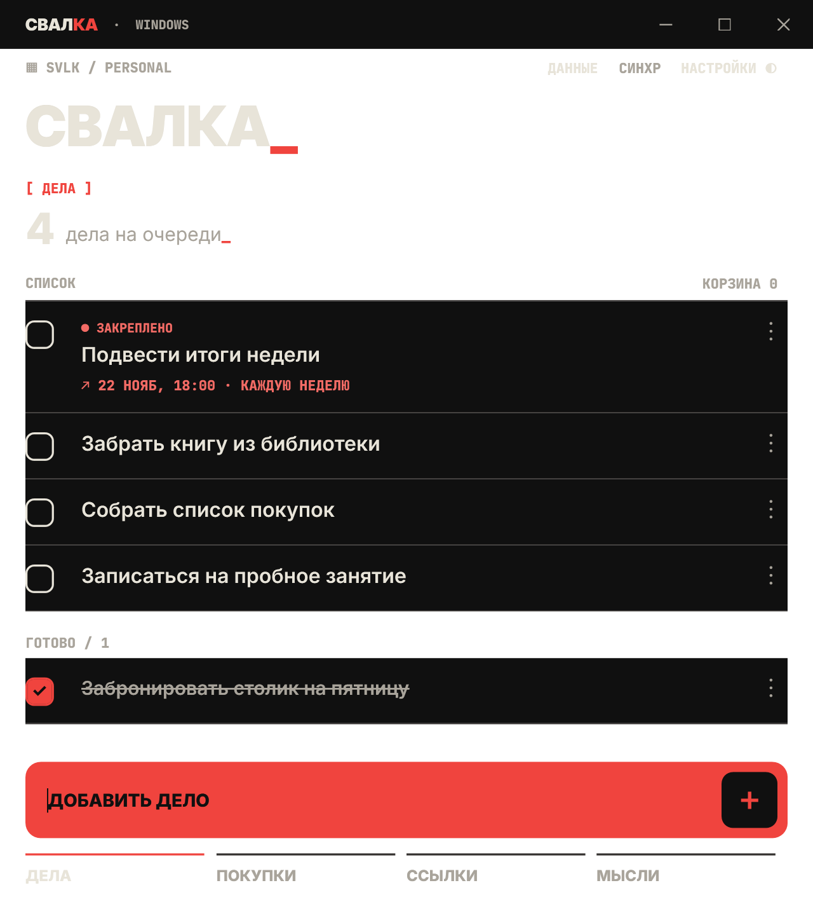

# СВАЛКА

Записывайте дела, собирайте список покупок и сохраняйте ссылки и мысли. Записям можно назначать напоминания. Данные хранятся на устройстве, для первого запуска сервер не нужен.

**[Android 7+ (APK)](https://github.com/cveloy102/reminder/releases/download/v2.1/Svalka-2.1.apk)** · **[Windows 10/11 (EXE)](https://github.com/cveloy102/reminder/releases/download/windows-v0.4.2/Svalka-Windows-Setup-0.4.2.exe)** · [Страница приложения](https://cveloy102.github.io/svalka/)

## Начало работы

1. Установите приложение на своё устройство. Версии для Android и Windows выпускаются отдельно.
2. В списке **«Дела»** создайте пробную запись и поставьте напоминание на ближайшую минуту.
3. Разрешите уведомления и, если Android попросит, точные напоминания. Дождитесь уведомления и нажмите **«Готово»**.

**Если напоминание не пришло** — проверьте разрешения и энергосбережение в [разделе о напоминаниях](#напоминания-и-данные). Если проблема повторяется, укажите систему и версию приложения в [сообщении об ошибке](https://github.com/cveloy102/reminder/issues/new).

[Синхронизировать телефон и ПК через свой сервер](docs/SELF_HOSTING.md) · [Все версии](https://github.com/cveloy102/reminder/releases) · [Сборка](docs/DEVELOPMENT.md)

## Интерфейс

### Android

[Вкладка «Мысли»](docs/images/list-thoughts.png) · [Редактор мысли](docs/images/thought-editor.png)

### Windows

*Свалка 0.4.2 для Windows с демонстрационными записями.*

## Возможности

- Четыре списка: дела, покупки, ссылки и мысли; у каждого своя корзина.
- Напоминания с датой и временем, повтор каждый день, неделю или месяц.
- Кнопки в уведомлении: «Готово», «Через 15 мин», «Через 1 час».
- Мысли с датой записи, многострочным вводом и кнопкой «Поделиться».
- Приём ссылок и текста из других приложений через «Поделиться → СВАЛКА».
- Закрепление и перестановка записей, выполненное ниже активного.
- «Очистить купленное» одной кнопкой; корзина очищается сама через 30 дней.
- Отмена удаления свайпом в течение десяти секунд.
- Резервная копия в файл и автокопия в выбранный файл Google Drive.
- Светлая, тёмная и системная темы в стиле Терминал, встроенные шрифты Inter и JetBrains Mono.

## Напоминания и данные

Ссылку из браузера можно отправить через «Поделиться», а текст записать во вкладке «Мысли». В разделе **«Данные»** можно сохранить резервную копию в файл или выбрать файл Google Drive для автокопии.

Записи хранятся локально. Облачная копия подключается по желанию: приложение обновляет выбранный файл, а Google Drive завершает загрузку при наличии сети. Пустой список автоматически в облако не записывается. Восстановление из файла может добавить только новые записи или заменить всё — перед заменой сохраните отдельную копию.

Если файл данных окажется повреждён, приложение не падает: файл откладывается в сторону, а на экране появляется сообщение.

Энергосбережение Android может влиять на доставку уведомлений. Для важного напоминания проверьте разрешения на своём телефоне. Приложение проверялось на POCO (HyperOS, Android 16).

## Что нового

- **Android 2.1 и Windows 0.4.2.** На Android обновлены скругления элементов и убраны полосы по краям при прокрутке. На Windows 11 скруглены углы окна.
- **В версии 2.0** появилась синхронизация телефона и компьютера через свой сервер. Как поднять сервер — [docs/SELF_HOSTING.md](docs/SELF_HOSTING.md).
- **Версия для Windows** поддерживает те же списки, напоминания и резервные копии ([windows/README.md](windows/README.md)).
- Вкладка «Мысли», повторяющиеся напоминания и кнопки в уведомлении (с версий 1.8–1.9).

Подробности — в [CHANGELOG](CHANGELOG.md).
